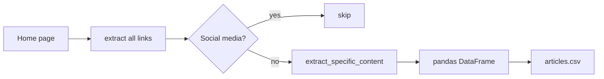

<h1 align="center">🕸️ News Web Scraper</h1>

<p align="center">Collect every link on a news site, skip the social media ones, and pull the headline, author, date, category and body from each article.</p>

<p align="center">
  
  
  
  
</p>

> **Building blocks only.** [`100.ipynb`](100.ipynb) defines the four functions but never calls them: there's no
> main loop or saved CSV yet. [Details →](#status--known-issues)

## Functions

| Function | Does |
|---|---|
| `extaract_all_links(url)` | GETs the page and returns every `<a href>` as an absolute URL |
| `is_social_media_url(url)` | Flags twitter, facebook, whatsapp and instagram links |
| `extract_specific_content(url)` | Returns heading, author, date, content, URL and category (from the first path segment) |
| `save_links_to_csv(links, file)` | Writes the links to a one-column CSV |

## Intended flow



```python
links = extaract_all_links("https://kathmandupost.com")
rows = [extract_specific_content(u) for u in links if not is_social_media_url(u)]
pd.DataFrame(rows, columns=["heading","author","date","content","url","category"]).to_csv("articles.csv", index=False)
```

## Status & known issues

| Issue | Effect | Fix |
|---|---|---|
| No driver code or target URL | Nothing runs end to end | Add the loop above |
| `csv.writer.writerow(['Link'])` | `AttributeError`: calls the class, not the `csv_writer` object | `csv_writer.writerow(['Link'])` |
| The social media check happens after the page is downloaded | A wasted request per skipped link | Check before `requests.get` |
| Selectors (`h1[style="margin-bottom: 0.1rem;"]`, `subscribe--wrapperx`) match the Kathmandu Post (the same as Cognifyz Task 3) | Other sites return "not found" for every field | Per-site selector config |
| No timeout, User-Agent or delay | Can hang, or get blocked | `timeout=10`, a header, `time.sleep` |
| Function name typo `extaract_` | Cosmetic | Rename |

## Roadmap

- [ ] Main loop and a sample CSV
- [ ] Respect `robots.txt`; deduplicate links; stay on the same domain
- [ ] Async version with `aiohttp` + `asyncio`
